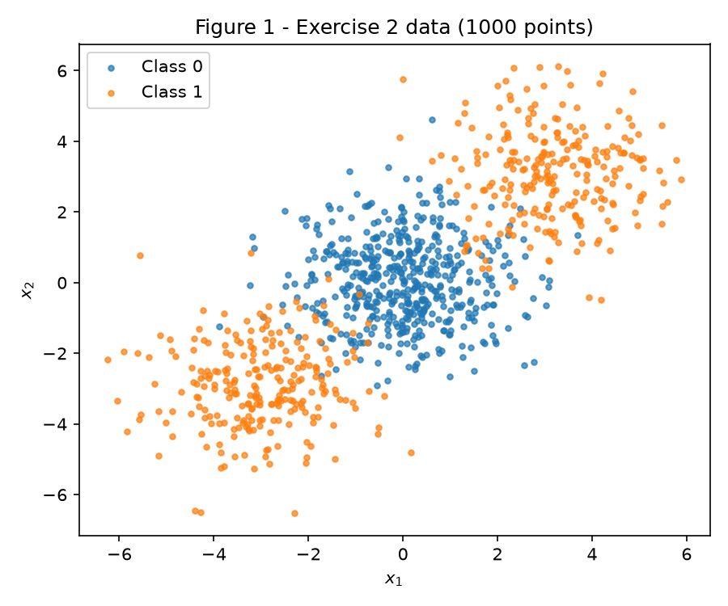
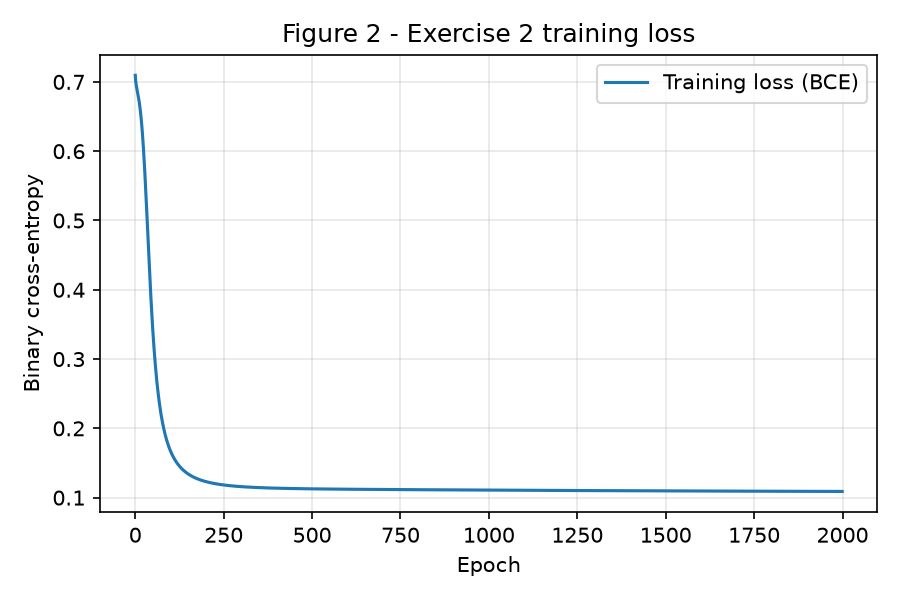
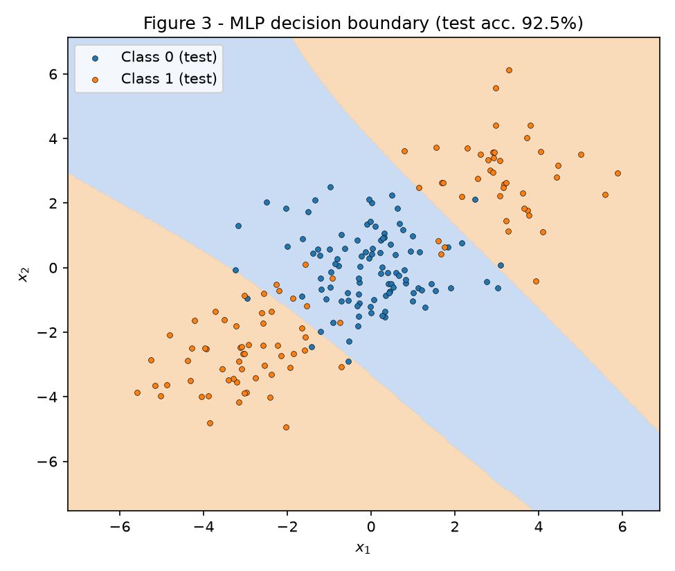
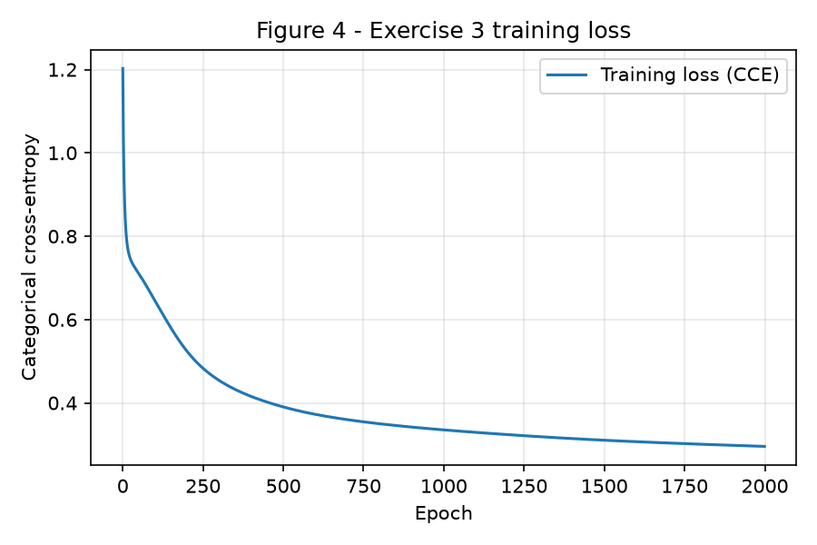
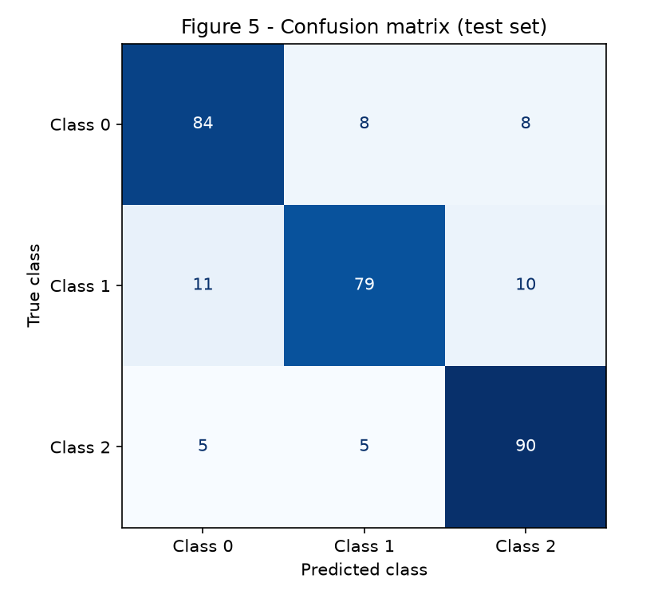
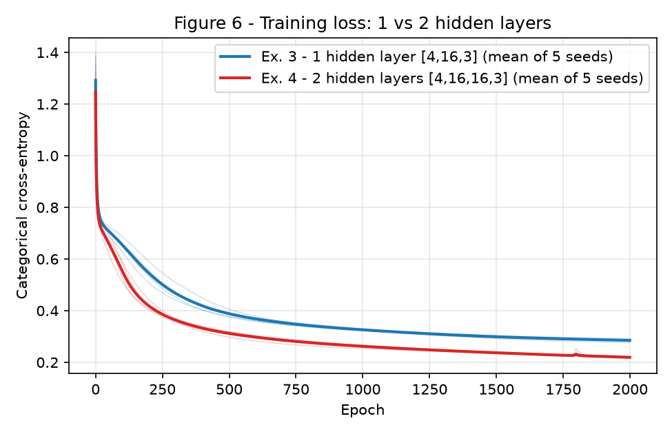

# 3. MLP

!!! abstract "Enunciado"
    [Exercises → MLP](https://insper.github.io/ann-dl/2026.2/exercises/mlp/)

## Exercise 1 { #exercise-1 }

Done by hand (numbers verified afterwards with a few lines of NumPy in `code/run_all.py`, which is *not* used to produce the derivations). All values are rounded to 4 decimals for display; intermediate values were carried with more digits. Setup: \(\mathbf{x}=[0.5,-0.2]\), \(y=1\), \(\eta=0.3\).

### A — Forward pass { #ex1-a }

\(\mathbf z^{(1)}=\mathbf W^{(1)}\mathbf x+\mathbf b^{(1)}\):

\[z^{(1)}_1 = 0.3(0.5)+(-0.1)(-0.2)+0.1 = 0.2700,\qquad z^{(1)}_2 = 0.2(0.5)+0.4(-0.2)-0.2 = -0.1800\]

\(\mathbf h^{(1)}=\tanh(\mathbf z^{(1)})\):

\[h^{(1)}_1=\tanh(0.27)=0.2636,\qquad h^{(1)}_2=\tanh(-0.18)=-0.1781\]

Output pre-activation, output and loss:

\[u^{(2)} = 0.5(0.2636)+(-0.3)(-0.1781)+0.2 = 0.1318+0.0534+0.2 = 0.3852\]

\[\hat y=\tanh(0.3852)=0.3672,\qquad L=(1-0.3672)^2=0.6328^2=0.4004\]

### B — Backward pass { #ex1-b }

**1. Output.** \(L=(y-\hat y)^2\) gives

\[\frac{\partial L}{\partial\hat y}=-2(y-\hat y)=-2(0.6328)=-1.2655\]

With \(\tanh'(u)=1-\tanh^2(u)\) we get \(1-\hat y^2=1-0.1349=0.8651\) and

\[\frac{\partial L}{\partial u^{(2)}}=\frac{\partial L}{\partial \hat y}\,(1-\hat y^2)=(-1.2655)(0.8651)=-1.0948\]

**2. Output layer.** Since \(u^{(2)}=\sum_j W^{(2)}_j h^{(1)}_j+b^{(2)}\), \(\partial u^{(2)}/\partial W^{(2)}_j=h^{(1)}_j\) and \(\partial u^{(2)}/\partial b^{(2)}=1\):

\[\frac{\partial L}{\partial \mathbf W^{(2)}}=-1.0948\,[0.2636,\,-0.1781]=[-0.2886,\ 0.1950],\qquad \frac{\partial L}{\partial b^{(2)}}=-1.0948\]

**3. Propagate back.** \(\partial u^{(2)}/\partial h^{(1)}_j=W^{(2)}_j\), then the \(\tanh\) derivative at layer 1 (\(1-h_1^2=0.9305\), \(1-h_2^2=0.9683\)):

\[\frac{\partial L}{\partial \mathbf h^{(1)}}=-1.0948\,[0.5,\,-0.3]=[-0.5474,\ 0.3284]\]

\[\frac{\partial L}{\partial \mathbf z^{(1)}}=[-0.5474(0.9305),\ 0.3284(0.9683)]=[-0.5094,\ 0.3180]\]

**4. Hidden layer.** \(\partial L/\partial W^{(1)}_{jk}=\delta_j x_k\) with \(\delta=\partial L/\partial\mathbf z^{(1)}\):

\[\frac{\partial L}{\partial \mathbf W^{(1)}}=\begin{bmatrix}-0.5094(0.5) & -0.5094(-0.2)\\ 0.3180(0.5) & 0.3180(-0.2)\end{bmatrix}=\begin{bmatrix}-0.2547 & 0.1019\\ 0.1590 & -0.0636\end{bmatrix},\qquad \frac{\partial L}{\partial \mathbf b^{(1)}}=[-0.5094,\ 0.3180]\]

### C — Parameter update { #ex1-c }

\(\theta\leftarrow\theta-0.3\,\partial L/\partial\theta\):

| Parameter | Before | After |
|---|---|---|
| \(\mathbf W^{(2)}\) | [0.5, −0.3] | [0.5866, −0.3585] |
| \(b^{(2)}\) | 0.2 | 0.5284 |
| \(\mathbf W^{(1)}\) | [[0.3, −0.1], [0.2, 0.4]] | [[0.3764, −0.1306], [0.1523, 0.4191]] |
| \(\mathbf b^{(1)}\) | [0.1, −0.2] | [0.2528, −0.2954] |

**Loss direction.** It goes **down**. The step is \(-\eta\nabla L\), so to first order \(\Delta L\approx-\eta\lVert\nabla L\rVert^2<0\), and the step is small enough for that approximation to hold. A second forward pass with the new parameters gives \(\hat y=0.7112\) and \(L=0.0834\), down from \(\hat y=0.3672\) and \(L=0.4004\) (target \(y=1\)).

## Exercise 2 { #exercise-2 }

### A — Generate the data { #ex2-a }

Data generated exactly as specified (`make_blobs`, centers (0,0), (3,3), (−3,−3), `cluster_std=1.2`, `random_state=42`); class 1 is the union of the two outer clusters. Split 80/20 with `train_test_split(..., test_size=0.2, random_state=42, stratify=y)` → 800 train / 200 test. The full code is in the collapsible blocks at the end of this exercise.

<figure markdown="span">
  
  <figcaption><strong>Figure 1</strong> — the 1000 points coloured by class: class 0 in the middle, class 1 split into two clusters on opposite sides of it.</figcaption>
</figure>

### B — Establish the baseline { #ex2-b }

A `LogisticRegression` fitted on the training set reaches **47.5%** test accuracy — below 50%, i.e. worse than guessing, and below the 60% you would get by always predicting class 0.

### C — Implement the MLP { #ex2-c }

The network is the class `MLP` in `code/mlp.py`, written with NumPy only: forward pass, loss, hand-derived backward pass and update. The layer sizes are an argument (`MLP([2, 8, 1], output="sigmoid")`). Hidden activation: \(\tanh\); output: sigmoid with binary cross-entropy; Xavier initialisation; full-batch gradient descent on standardised inputs (mean/std computed on the training set only). I verified the analytical gradients against central finite differences on a small batch: maximum absolute error **2.1e-11**.

For sigmoid + BCE the gradient with respect to the output pre-activation simplifies to \(\partial L/\partial u=(\hat p-y)/N\), which is what `backward` starts from, then applies \(\mathbf W^{(l)\top}\) and \(1-h^2\) layer by layer.

| Item | Value |
|---|---|
| Architecture | 2 → 8 (tanh) → 1 (sigmoid), 33 parameters |
| Learning rate / epochs | 0.5 / 2000 (full batch) |
| Final training loss | 0.1089 |
| Train accuracy | 96.38% |
| **Test accuracy** | **92.5%** |

<figure markdown="span">
  
  <figcaption><strong>Figure 2</strong> — training loss (binary cross-entropy) per epoch.</figcaption>
</figure>

<figure markdown="span">
  
  <figcaption><strong>Figure 3</strong> — decision boundary of the MLP over the test points; shaded regions are the predicted classes.</figcaption>
</figure>

### D — Analysis { #ex2-d }

Class 1 lives on *both* sides of class 0, and the data are roughly symmetric about the origin. A linear model can only output one half-plane for class 1, and any half-plane that captures one outer cluster necessarily lands on the other side of the class-0 blob, so it gains on one side what it loses on the other. By that symmetry a linear score carries almost no information about the class, and the resulting labelling is essentially chance-level:47.5%, worse even than the majority-class rate.

Figure 3 shows what the hidden layer buys: the network assigns class 0 to a **diagonal band** running from top-left to bottom-right through the origin, and class 1 to **two disconnected regions**, one on each side of that band (top-right and bottom-left). Each hidden \(\tanh\) unit contributes one soft linear boundary; the output unit combines them so that "between the two lines" means class 0 and "outside" means class 1. That is a non-convex, disconnected class-1 region, and a single line has only one side to give, so no single straight line can produce it. The network reaches 92.5% on test; the remaining errors are plausibly points where the class-0 blob and the outer clusters overlap (std 1.2 makes them overlap), though I did not inspect them individually.

??? example "Code — mlp.py (MLP from scratch)"

    ```python
    --8<-- "docs/exercises/mlp/code/mlp.py"
    ```

??? example "Code — run_all.py (data generation, training, figures, all exercises)"

    ```python
    --8<-- "docs/exercises/mlp/code/run_all.py"
    ```

## Exercise 3 { #exercise-3 }

### A — Generate the data { #ex3-a }

`make_classification(n_samples=1500, n_features=4, n_informative=4, n_redundant=0, n_repeated=0, n_classes=3,
n_clusters_per_class=2, class_sep=1.0, random_state=42)`, split 80/20 with the same seed and `stratify=y` → 1200 train / 300 test. Features are standardised with training-set statistics.

### B — Adapt the network { #ex3-b }

Only the output layer and loss change: 3 output units, softmax, categorical cross-entropy (one-hot targets). The `MLP` class is the **same file, untouched** (`code/mlp.py`): its forward, backward and update code are shared with Exercise 2, and `output`, the layer sizes, the loss branch and the hyperparameters are arguments.

**Derivation of \(\partial L/\partial u\) for softmax + cross-entropy.** With \(p_k=e^{u_k}/\sum_j e^{u_j}\) and \(L=-\sum_k y_k\log p_k\) (\(y\) one-hot, \(\sum_k y_k=1\)):

\[\frac{\partial p_k}{\partial u_j}=p_k(\delta_{kj}-p_j)\]

\[\frac{\partial L}{\partial u_j}=-\sum_k \frac{y_k}{p_k}\,p_k(\delta_{kj}-p_j)=-\sum_k y_k\delta_{kj}+p_j\sum_k y_k=-y_j+p_j\]

so \(\partial L/\partial \mathbf u=\mathbf p-\mathbf y\) (divided by \(N\) for the batch mean). The softmax Jacobian and the \(1/p_k\) from the log cancel exactly, leaving "prediction minus target" — the same expression as sigmoid + BCE, which is why the backward pass in Exercise 2 did not need to change.

### C — Train and evaluate { #ex3-c }

| Item | Value |
|---|---|
| Architecture | 4 → 16 (tanh) → 3 (softmax), 131 parameters |
| Learning rate / epochs | 0.3 / 2000 (full batch) |
| Final training loss | 0.2957 |
| Train accuracy | 88.42% |
| **Test accuracy** | **84.33%** |

<figure markdown="span">
  
  <figcaption><strong>Figure 4</strong> — training loss (categorical cross-entropy) per epoch.</figcaption>
</figure>

<figure markdown="span">
  
  <figcaption><strong>Figure 5</strong> — confusion matrix on the 300 test samples.</figcaption>
</figure>

### D — Analysis { #ex3-d }

Confusion matrix (rows = true class, columns = predicted): class 0 → [84, 8, 8], class 1 → [11, 79, 10], class 2 → [5, 5, 90]. Summing both directions, classes 0 and 1 are confused 19 times, classes 1 and 2 15 times, and classes 0 and 2 13 times, so the **most-confused pair is 0 and 1**. The gap is small (19 vs 15 vs 13 errors on 300 samples), so I would not over-read it.

A likely explanation comes from how the data are built. There are 6 clusters (2 per class) in 4 dimensions, each with unit variance and placed with `class_sep=1.0`, so neighbouring clusters overlap substantially, including clusters of *different* classes. A class is therefore two separate blobs, and a test point near the overlap between a blob of class A and a blob of class B has a posterior split between A and B no matter how good the model is. That overlap sets a ceiling on accuracy (and the generator also flips about 1% of labels by default), so errors concentrate wherever blobs of two classes sit closest. I did not measure the distances between cluster centres, so which exact pair of clusters is responsible is a hypothesis, not a measurement.

The logistic-regression baseline on this data reaches **66.3%**. The hidden layer lifts this to 84.3% (about +18 points) because each class is a union of two clusters, which a single linear softmax boundary per class cannot represent; the 16 tanh units let the network carve a different region for each cluster.

## Exercise 4 { #exercise-4 }

### A — Train the deeper network { #ex4-a }

Same data, split, standardisation, learning rate (0.3) and budget (2000 full-batch epochs) as Exercise 3. The only change is depth: **4 → 16 → 16 → 3** (two tanh hidden layers, 403 parameters, same `MLP` class). Test accuracy for seed 42: **86.00%**. Seeds only change the weight initialisation; the data split is fixed.

### B — Compare { #ex4-b }

Both architectures were trained with 5 seeds (42, 43, 44, 45, 46, each with `np.random.default_rng(seed)`) and averaged. (The Exercise 3 headline number above comes from the single shared `rng` stream of the report, so it is not identical to the seed-42 row below.)

<figure markdown="span">
  
  <figcaption><strong>Figure 6</strong> — training-loss curves of the 1-hidden-layer and 2-hidden-layer networks (thin lines: individual seeds, thick lines: mean over 5 seeds).</figcaption>
</figure>

|  | hidden layers | parameters | final train loss (mean) | train acc. (mean) | test accuracy (mean ± std) |
|---|---|---|---|---|---|
| Exercise 3 | 1 | 131 | 0.2850 | 89.88% | 83.93% ± 0.83 |
| Exercise 4 | 2 | 403 | 0.2194 | 92.07% | 85.67% ± 0.70 |

??? note "Per-seed results"

    | Seed | Ex. 3 test acc. | Ex. 3 train loss | Ex. 4 test acc. | Ex. 4 train loss |
    |---|---|---|---|---|
    | 42 | 83.00% | 0.2845 | 86.00% | 0.2157 |
    | 43 | 83.33% | 0.2843 | 86.00% | 0.2216 |
    | 44 | 85.33% | 0.2921 | 85.67% | 0.2233 |
    | 45 | 84.33% | 0.2764 | 84.33% | 0.2177 |
    | 46 | 83.67% | 0.2876 | 86.33% | 0.2186 |

Mean test-accuracy difference (Ex. 4 − Ex. 3): **+1.73 percentage points**.

### C — Analysis { #ex4-c }

What I measured: in this run the deeper network was **slightly better, not worse**: 85.67% against 83.93% test accuracy, and a lower final training loss (0.219 vs 0.285). I report this as it came out and did not tune anything to change it. The gain (1.7 points, about two seed-to-seed standard deviations, and equivalent to ~5 of the 300 test samples) is modest and I would not call it large evidence of an advantage.

- **Training loss vs test accuracy.** The training-loss gap is clear and consistent across seeds (Figure 6), but the test gain is much smaller. Train accuracy rises from 89.9% to 92.1% while test goes from 83.9% to 85.7%: the generalisation gap does not shrink (≈6.0 vs ≈6.4 points), so most of the extra fit does not carry over to new data.
- **Optimisation, not just representation.** The 1-hidden-layer curve is still falling at epoch 2000, so with a fixed budget the shallow net is partly under-trained. A deeper (and 3× larger) net with the same learning rate descends faster, which can explain part of the advantage independently of representational power. A longer run for the shallow net would probably narrow the gap; I did not test it, so this is a hypothesis.
- **Data complexity.** Six clusters in four dimensions need a boundary with a handful of regions, which one hidden layer with 16 units already represents (the 16-unit net can place several soft hyperplanes). A second layer lets the network compose features from features, but there is little hierarchical structure to compose here, and the ceiling is set by cluster overlap, not by model capacity — which is why the test gain is small.
- **What data would reward depth.** Data with compositional or hierarchical structure and many more regions: images, audio or text (edges → parts → objects), or tasks like parity / XOR in many dimensions that need exponentially many units in one layer but few with depth, and with enough samples to fit the extra parameters.

## Results summary { #results-summary }

| # | Quantity | Value |
|---|---|---|
| 1 | Ex. 1 — \(\mathbf z^{(1)}\) and \(\mathbf h^{(1)}\) | \(\mathbf z^{(1)}=[0.2700,\,-0.1800]\); \(\mathbf h^{(1)}=[0.2636,\,-0.1781]\) |
| 2 | Ex. 1 — \(u^{(2)}\), \(\hat y\) and \(L\) | \(u^{(2)}=0.3852\); \(\hat y=0.3672\); \(L=0.4004\) |
| 3 | Ex. 1 — the eight updated parameters | \(\mathbf W^{(2)}=[0.5866,-0.3585]\), \(b^{(2)}=0.5284\), \(\mathbf W^{(1)}=[[0.3764,-0.1306],[0.1523,0.4191]]\), \(\mathbf b^{(1)}=[0.2528,-0.2954]\) |
| 4 | Ex. 2 — linear baseline test accuracy | 47.5% |
| 5 | Ex. 2 — architecture and test accuracy | 2→8→1 (tanh, sigmoid), lr 0.5, 2000 epochs: 92.5% |
| 6 | Ex. 3 — architecture and test accuracy | 4→16→3 (tanh, softmax), lr 0.3, 2000 epochs: 84.33% (linear baseline 66.3%) |
| 7 | Ex. 3 — most-confused class pair | Classes 0 and 1 (19 errors of 300) |
| 8 | Ex. 4 — architecture and test accuracy | 4→16→16→3, same lr/epochs: 85.67% (mean of 5 seeds; seed 42: 86.00%) |
| 9 | Ex. 4 — accuracy difference against Ex. 3 (mean over ≥ 3 seeds) | +1.73 percentage points (85.67% vs 83.93%; 5 seeds) |

## Discussion { #discussion }

The thread through the four exercises is what a hidden layer buys. By hand, backpropagation is just the chain rule applied layer by layer, and one step cut the loss from 0.4004 to 0.0834. In Exercise 2 the same idea turns a problem where a linear model scores 47.5% into one the MLP solves at 92.5%, by carving a band-shaped class-0 region with two disconnected class-1 regions around it. Exercise 3 showed that the same code handles three classes once the output layer and the loss are swapped, because softmax + cross-entropy gives the same \(\hat p-y\) gradient. Exercise 4 showed that an extra layer did not change the picture much on this data: a small accuracy gain (+1.7 points) and a clearer drop in training loss, partly attributable to faster optimisation under a fixed budget.

Limitations: full-batch gradient descent with hand-picked learning rates (not tuned on a validation set), a single data split, 5 seeds, and a 300-sample test set where one sample is 0.33 points.

**AI use:** Claude (Anthropic) was used to refine the text and assist with code implementation. I am responsible for understanding and being able to explain every part.

## Conclusion { #conclusion }

A from-scratch MLP with one hidden layer solves the non-linearly-separable problem (92.5% vs 47.5% for the linear baseline) and extends to multi-class with only a softmax/cross-entropy swap (84.3% vs 66.3%). A second hidden layer gave only a modest improvement (+1.7 points over 5 seeds), a result limited by cluster overlap rather than model capacity.
