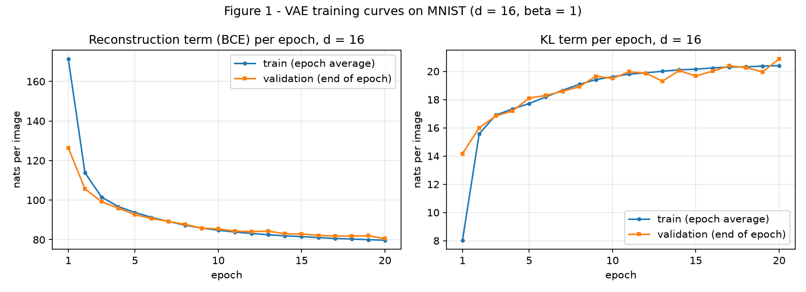
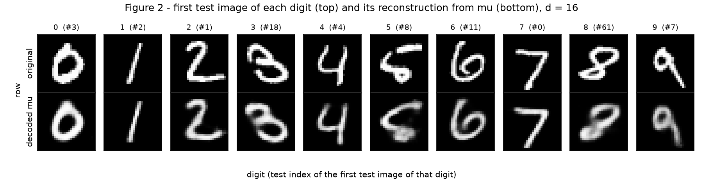
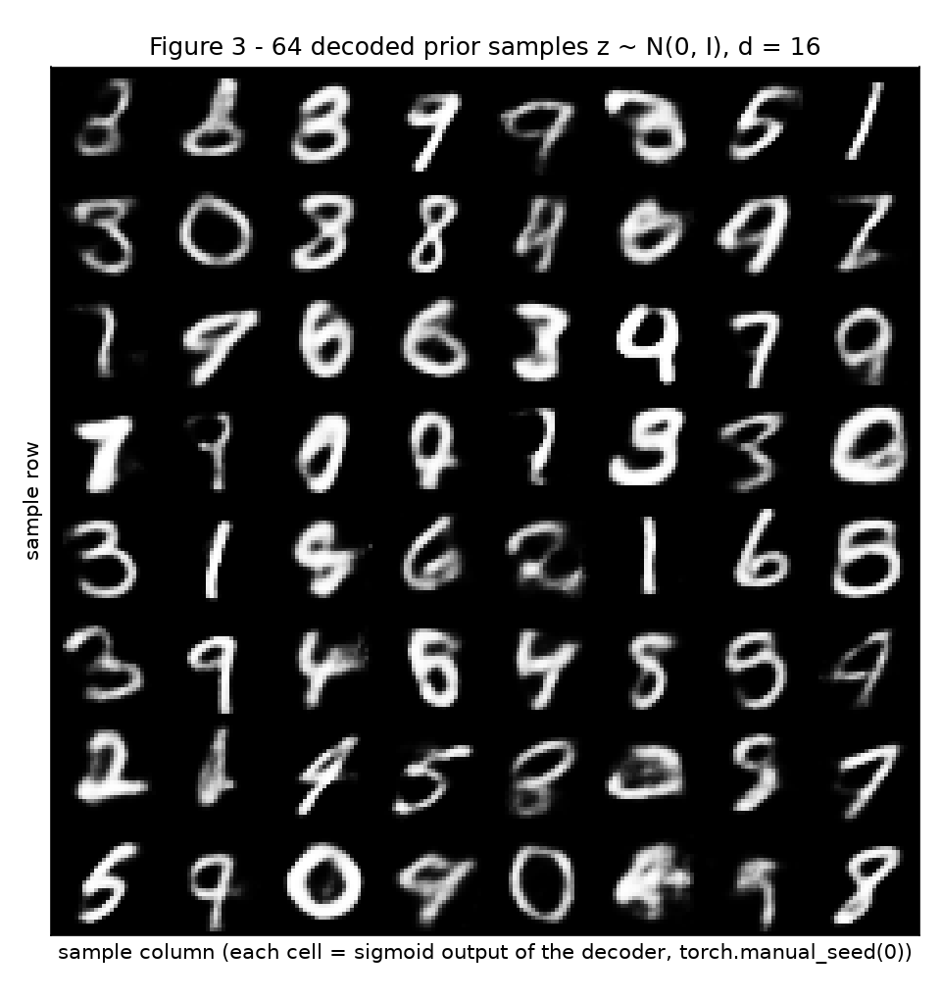
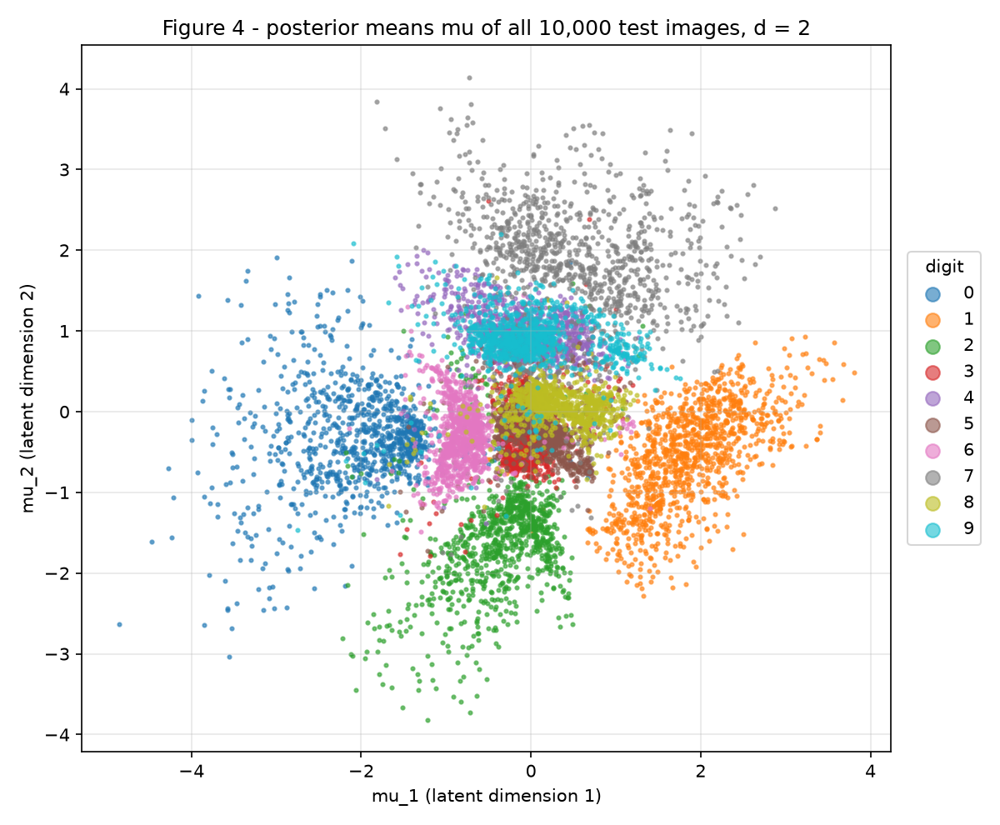
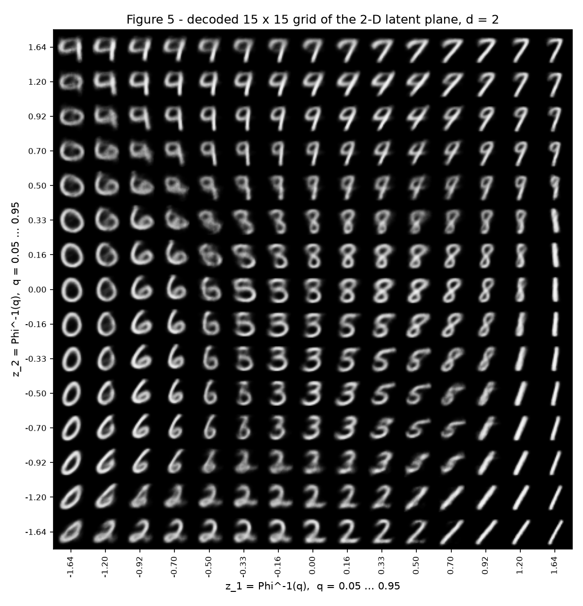
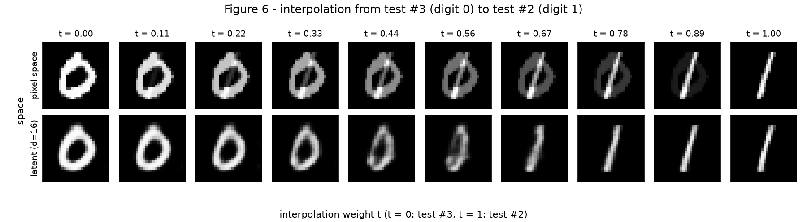

# 4. VAE

!!! abstract "Statement"

    [Exercises → VAE](https://insper.github.io/ann-dl/){:target='_blank'} (open the current edition, then *Exercises → VAE*).

!!! info "Reproduction and conventions"

    Everything comes from one script, run from this folder:

    ```bash
    cd docs/exercises/vae && python code/vae.py
    ```

    It downloads MNIST into `data/` (not committed), trains both models on CPU in about one minute, writes Figures 1–6 to `figures/` and **every number quoted below to `figures/results.json`**. Two consecutive runs produced byte-identical `results.json` and figure files (PyTorch 2.15, 4 CPU threads).

    - Seeds: `torch.manual_seed(42)` before each model, the split generator seeded with 42, a separate generator seeded with 42 for the mini-batch order, and a fixed generator (seed 123) for the one $z$ sampled per image when the validation/test loss is evaluated.
    - Units: reconstruction and KL are always reported **separately, in nats per image** (summed over the 784 pixels or the $d$ latent dimensions, averaged over images).
    - Test-set discipline: both models are trained first, using only the train and validation splits; the test set is used only afterwards, for the final numbers, the figures and the diagnostics.

    ??? note "Full script (`code/vae.py`)"

        ``` { .python .copy linenums='1' title="docs/exercises/vae/code/vae.py" }
        --8<-- "docs/exercises/vae/code/vae.py"
        ```

!!! note "AI use"

    Claude Code (Anthropic, model Claude Opus 5.5) was used as an assistant to write the code in `code/vae.py` and to draft this text. The numbers and figures were produced by running the script, and every number in the text was taken from `figures/results.json`.

## Exercise 1

### A. Load and split the data

MNIST is loaded from `torchvision` with `ToTensor()`, which maps the `uint8` pixels to $[0, 1]$; every image is flattened to a 784-vector. The 60,000 official training images are split into 50,000 train and 10,000 validation images with `random_split(..., generator=torch.Generator().manual_seed(42))`, and the 10,000 official test images are the test set. Resulting shapes: train `(50000, 784)`, validation `(10000, 784)`, test `(10000, 784)`, pixel range 0.0–1.0. The test tensors are built here but not touched until both models are trained (Exercise 1C).

??? note "Code — data"

    ``` { .python .copy }
    --8<-- "docs/exercises/vae/code/vae.py:data"
    ```

### B. Build the model

**Architecture ($d = 16$).** Encoder 784 → 512 → 256 with ReLU after each layer, followed by two linear heads 256 → $d$, one for $\boldsymbol\mu$ and one for $\log\boldsymbol\sigma^2$. Decoder $d$ → 256 → 512 → 784 with ReLU on the hidden layers and a sigmoid on the output.

**Hand-written parts.** No library VAE class and no `kl_divergence` are used:

- *Reparameterization:* $z = \mu + \sigma \odot \varepsilon$, with $\sigma = \exp(\tfrac12 \log\sigma^2)$ and $\varepsilon \sim \mathcal N(0, I)$. The randomness sits in $\varepsilon$, so gradients flow through $\mu$ and $\sigma$.
- *Reconstruction:* Bernoulli negative log-likelihood (BCE), **summed over the 784 pixels**. The last decoder layer produces the pre-sigmoid values $l$ (logits); `decode()` applies the sigmoid, $p = \sigma(l)$, and that is what all the figures show. The loss is written in terms of $l$:
  $-[x\log p + (1-x)\log(1-p)] = \operatorname{softplus}(l) - x\,l$,
  which is the same BCE, but it never evaluates $\log 0$ when the sigmoid saturates.
- *KL (closed form):* $\mathrm{KL} = -\tfrac12\sum_{j=1}^{d}\big(1 + \log\sigma_j^2 - \mu_j^2 - \sigma_j^2\big)$.
- *Loss:* $(\sum_\text{batch}\text{recon} + \beta\sum_\text{batch}\text{KL})/B$ with $\beta = 1$, i.e. the negative ELBO per image averaged over the batch.

The statement suggests `F.binary_cross_entropy(..., reduction="sum")`. I kept the hand-written form required by the rubric and checked it against that function: on a 256 × 784 batch (float64) the two agree to a relative difference of 7.62e-15 (`bce_check` in `results.json`).

**Why BCE and not squared error.** The loss is a log-likelihood, so it encodes a choice of noise model. Squared error corresponds to a Gaussian likelihood around the decoder output, while BCE corresponds to a Bernoulli likelihood for each pixel. MNIST pixels are almost all 0 or 1: only 9% of test pixels lie strictly between 0.1 and 0.9 (`grey_frac_test_images` = 0.09). A per-pixel Bernoulli therefore matches the data, and the sigmoid output is exactly its mean.

??? note "Code — model and loss"

    ``` { .python .copy }
    --8<-- "docs/exercises/vae/code/vae.py:model"
    ```

    ``` { .python .copy }
    --8<-- "docs/exercises/vae/code/vae.py:check"
    ```

### C. Train

Adam, learning rate $10^{-3}$, batch size 128, 20 epochs, $d = 16$, $\beta = 1$. In each epoch, the train point is the average of the per-batch terms over that epoch (the weights change during it). The validation point is measured with the weights at the end of the epoch, using one sampled $z$ per image. Both models are trained before the test set is used.

Selected epochs (nats per image; all 20 epochs are in `results.json → ex1.history`):

| Epoch | Train recon. | Train KL | Val. recon. | Val. KL |
|---:|---:|---:|---:|---:|
| 1 | 171.37 | 8.03 | 126.45 | 14.17 |
| 2 | 113.82 | 15.57 | 105.65 | 16.00 |
| 3 | 101.47 | 16.90 | 99.19 | 16.84 |
| 5 | 93.75 | 17.72 | 92.60 | 18.11 |
| 10 | 84.77 | 19.61 | 85.42 | 19.49 |
| 20 | 79.71 | 20.41 | 80.49 | 20.88 |

**1. Test numbers ($d = 16$), computed once at the end:** reconstruction **79.75** nats, KL **20.96** nats, negative ELBO **100.71** nats per image. This is close to the statement's reference values (about 81 and 20).

At epoch 1 the train curve lies above validation in reconstruction (171.37 vs 126.45) and below it in KL (8.03 vs 14.17). This is because the train point averages over the whole first epoch, including the first batches of an untrained network, while the validation point uses the end-of-epoch weights. From epoch 3 on the two curves practically coincide. At epoch 20 train and validation reconstruction are 79.71 and 80.49, so no overfitting is visible within this budget.

**2. Figure 1.**

<figure markdown="span">
  { width="100%" }
  <figcaption><strong>Figure 1</strong> — Reconstruction term (left) and KL term (right) per epoch for the d = 16 VAE, in nats per image; train = average over the epoch, validation = end of the epoch.</figcaption>
</figure>

??? note "Code — training loop, test evaluation and Figure 1"

    ``` { .python .copy }
    --8<-- "docs/exercises/vae/code/vae.py:train"
    ```

    ``` { .python .copy }
    --8<-- "docs/exercises/vae/code/vae.py:fit"
    ```

    ``` { .python .copy }
    --8<-- "docs/exercises/vae/code/vae.py:fig1"
    ```

### D. Reconstructions and samples

**Figure 2** uses the first test image of each digit (test indices 3, 2, 1, 18, 4, 8, 11, 0, 61, 7 for digits 0–9). Each image is encoded, and its **mean $\mu$** is decoded, with no sampling. **Figure 3** decodes 64 draws $z \sim \mathcal N(0, I)$ taken right after `torch.manual_seed(0)`. Each cell shows the sigmoid output (the pixel means), not a binarized sample.

<figure markdown="span">
  { width="100%" }
  <figcaption><strong>Figure 2</strong> — Top: first test image of each digit (test index in parentheses). Bottom: reconstruction obtained by decoding the posterior mean μ, d = 16.</figcaption>
</figure>

<figure markdown="span">
  { width="70%" }
  <figcaption><strong>Figure 3</strong> — 64 latent vectors z ~ N(0, I) (seed 0) decoded by the d = 16 model; each cell is the decoder's sigmoid output.</figcaption>
</figure>

All ten reconstructions in Figure 2 are recognisable as the right digit. They are smoother than the originals, and the hardest strokes are lost: the loop of the 8 is filled in, and the 5's lower part is blurred. In Figure 3 most samples are readable digits, but several are not. For example, the cells at row 4/column 2, row 7/column 2 and row 8/column 6 are stroke fragments rather than digits, and many others are blurrier than any reconstruction in Figure 2.

??? note "Code — Figures 2 and 3"

    ``` { .python .copy }
    --8<-- "docs/exercises/vae/code/vae.py:fig2"
    ```

    ``` { .python .copy }
    --8<-- "docs/exercises/vae/code/vae.py:fig3"
    ```

### E. Analysis

The diagnostics quoted here are computed on the test set after training (block below; values in `results.json → ex1.diag` and `ex1.epoch1_summary`).

??? note "Code — diagnostics"

    ``` { .python .copy }
    --8<-- "docs/exercises/vae/code/vae.py:diag1"
    ```

**1. Why the KL rises in the first epochs while the total loss falls.** The KL measures how much information the code $z$ carries about the image, i.e. how far each posterior $q(z\mid x)$ moves away from the prior. At initialization the posteriors are almost equal to the prior: on the first batch the KL is 0.03 nats while the reconstruction is terrible (total 544.72 nats per image). After a short transient at the very start (peak 17.52 nats at step 9, an initialization effect I did not investigate further), the KL drops back to 0.15 nats at step 31. At that point the model is reconstructing mostly from the decoder's average image. From there the KL climbs steadily, to 13.96 nats on the last batch of epoch 1, 14.17 on validation at the end of epoch 1, and 20.88 on validation at epoch 20. Meanwhile the per-batch total keeps falling: 544.72 → 221.88 (step 20) → 129.92 (last step of epoch 1). The rise is the price of a better reconstruction. To reconstruct a specific digit, the encoder must move $q(z\mid x)$ away from $\mathcal N(0, I)$, which costs KL. Early on, each extra nat of KL buys many nats of reconstruction, so the sum goes down even though one of its terms goes up. When the gains get smaller, the KL levels off: train KL changes by less than one nat over the last 10 epochs (19.61 at epoch 10, 20.41 at epoch 20). The model does not spend this budget evenly. Measured on the test set, 12 of the 16 latent dimensions carry more than 0.1 nat of KL each, and the other 4 have KL ≈ 0.00, i.e. they stayed at the prior and are unused.

**2. Why Figure 3 looks worse than Figure 2 — two separate reasons.**

*(a) Where prior samples land.* Figure 2 decodes $\mu$ of real images, which are points the decoder was trained around. Figure 3 decodes points drawn from $\mathcal N(0, I)$, and the encoded data does not fill that prior evenly. The average posterior standard deviation is only 0.40, so each image occupies a small region, and 4 dimensions are unused. I measured the distance from each point to its nearest encoded test mean $\mu$:

- the median distance is 2.71 for 10,000 prior draws, against 1.45 for encoded validation images;
- 92% of prior draws are farther from every test $\mu$ than 95% of validation codes are.

Many prior samples therefore fall *between* the regions the encoder actually uses. The decoder has seen few or no training codes there, so it returns mixtures of digits or fragments, such as the non-digits in Figure 3.

*(b) What the decoder outputs for a given $z$.* The decoder does not output an image. It outputs the per-pixel Bernoulli **mean**, and that mean is what is displayed. When a code is compatible with several sharp images (different stroke positions or thicknesses), the loss-minimizing output is their average, and an average of images is blurry. This is the point of the lecture's section on blur ([course site](https://insper.github.io/ann-dl/){:target='_blank'} → *Classes → Variational Autoencoders → Why the samples are blurry and why it does not matter*): the objective gets exactly what it asks for. The share of grey pixels (strictly between 0.1 and 0.9) quantifies this:

| Images | Share of grey pixels |
|---|---:|
| Real test images | 0.09 |
| Reconstructions from $\mu$ | 0.14 |
| Prior samples | 0.17 |

Prior samples are the most uncertain codes of the three (reason a), so their averages are the blurriest.

**3. Why decode $\mu$ instead of a sampled $z$ in Figure 2.** $\mu$ is the centre of $q(z\mid x)$, the model's single best guess of the code. Decoding it gives one deterministic, reproducible reconstruction. A sampled $z = \mu + \sigma\varepsilon$ adds noise of size $\sigma$ (0.40 on average per dimension), so each run would show a slightly different and usually worse image, mixing the model's quality with sampling noise. Measured on the whole test set:

- decoding $\mu$ gives a reconstruction term of 74.68 nats per image;
- decoding one sampled $z$ gives 79.81;
- $\mu$ is better for 94% of the images.

The sampled version is the right quantity for the ELBO (it is what the test numbers in 1C use), but $\mu$ is the right image to *show*.

## Exercise 2

### A. Train a 2-D VAE

Same data, architecture, seed (42), $\beta = 1$ and budget (Adam $10^{-3}$, batch 128, 20 epochs), with only $d = 2$. The same `fit(d)` function is used: `fit(2)` (code in Exercise 1C). Test results, next to the $d = 16$ model:

| Model | Test reconstruction | Test KL | Test negative ELBO |
|---|---:|---:|---:|
| $d = 16$ | 79.75 | 20.96 | 100.71 |
| $d = 2$ | 134.82 | 6.85 | 141.68 |

The numbers are close to the statement's reference values (about 135 and 7). With two latent numbers, the code carries about a third of the information (KL 6.85 vs 20.96 nats), and the reconstruction is much worse (134.82 vs 79.75). The $d = 2$ model's validation KL went from 4.85 (epoch 1) to 6.86 (epoch 20).

### B. The encoded test set

<figure markdown="span">
  { width="85%" }
  <figcaption><strong>Figure 4</strong> — Posterior means μ of all 10,000 test images under the d = 2 model, coloured by the true digit.</figcaption>
</figure>

The plane is organised by digit. 0 (left), 1 (right), 2 (bottom) and 7 (top) form fairly separate lobes. The centre holds two crowded areas where colours mix: 4 with 9 (around $\mu_2 \approx 1$), and 3, 5 and 8 (around the origin), with 6 next to them.

??? note "Code — Figure 4"

    ``` { .python .copy }
    --8<-- "docs/exercises/vae/code/vae.py:fig4"
    ```

### C. The decoded plane

The grid uses $z = \Phi^{-1}(q)$ on both axes, with $q$ = 15 evenly spaced values in $[0.05, 0.95]$ (`scipy.stats.norm.ppf`). This gives $z$ from −1.64 to 1.64 (`ex2.grid_z_values`). Each latent pair is decoded with the $d = 2$ model. **The top row is the largest $z_2$**, and the axes are labelled with the $z$ value of each column and row.

**Why this spacing gives equal prior mass per cell:** since $\Phi^{-1}$ is the inverse CDF of $\mathcal N(0,1)$, equal steps in $q$ enclose equal prior probability $(0.95-0.05)/14$ along each axis, and because the prior's two coordinates are independent, every cell gets the same mass, the product of the two.

<figure markdown="span">
  { width="85%" }
  <figcaption><strong>Figure 5</strong> — Decoded 15 × 15 grid of the d = 2 latent plane, z = Φ⁻¹(q) with q evenly spaced in [0.05, 0.95]; top row = largest z₂.</figcaption>
</figure>

??? note "Code — Figure 5"

    ``` { .python .copy }
    --8<-- "docs/exercises/vae/code/vae.py:fig5"
    ```

### D. Interpolation

**Pair and rule.** Test **#3** (digit 0) and test **#2** (digit 1). The rule was fixed before looking at Figure 6: take the first test image of digit 0 and the first test image of digit 1, which are the two leftmost columns of Figure 2. Their reconstructions are therefore already on display, and a 0 and a 1 share almost no ink, so a pixel blend cannot look like either digit.

I checked that the endpoints themselves are well reconstructed by the $d = 16$ model. Decoding $\mu$ gives 74.44 nats for #3 and 30.82 nats for #2. Only 29% and 33% of the test images of the same digit are reconstructed at least as well, so both endpoints are in the better-reconstructed third of their class. Figure 2 shows both endpoint reconstructions are faithful.

Figure 6 uses $t = 0, 1/9, \dots, 1$ (10 values). The top row is the pixel-space blend $(1-t)\,x_a + t\,x_b$. The bottom row decodes $(1-t)\,\mu_a + t\,\mu_b$ with the **$d = 16$ model** of Exercise 1.

<figure markdown="span">
  { width="100%" }
  <figcaption><strong>Figure 6</strong> — Interpolation from test #3 (digit 0) to test #2 (digit 1). Top: linear blend in pixel space. Bottom: decoded linear blend of the posterior means μ in the d = 16 latent space.</figcaption>
</figure>

??? note "Code — Figure 6 and the digit-likeness proxy"

    ``` { .python .copy }
    --8<-- "docs/exercises/vae/code/vae.py:fig6"
    ```

    ``` { .python .copy }
    --8<-- "docs/exercises/vae/code/vae.py:diag3"
    ```

### E. Analysis

The diagnostics below are in `results.json → ex2.diag` and `ex2.interp`.

??? note "Code — diagnostics"

    ``` { .python .copy }
    --8<-- "docs/exercises/vae/code/vae.py:diag2"
    ```

**1. Which digits overlap, and what the transition looks like in Figure 5.** In Figure 4 the overlaps are **4 with 9** and **3 with 5 and 8**. To make this measurable, I fit a 15-nearest-neighbour classifier on the validation set's 2-D $\mu$ and applied it to the test $\mu$. It is right for 78.87% of test images. The most confused pairs (errors in both directions) are:

| Pair | Errors |
|---|---:|
| 4–9 | 704 |
| 3–5 | 338 |
| 3–8 | 182 |
| 5–8 | 153 |
| 7–9 | 99 |

In Figure 5:

- **4/9** sits in the upper middle ($z_2 \approx 0.50$–$1.20$). The decoder draws almost only 9s there. Going right, toward $z_1 \approx 0.50$, the 9's loop opens at the top and its stroke becomes angular, giving an open-top 4. These 4-like cells are flanked by 9s on both sides, and there is no area of clean, distinct 4s. Assigning each grid cell the digit of its nearest validation codes (same 15-NN rule, `grid_nearest_digit_rows_top_to_bottom`) labels many of these 9-looking cells as "4". In other words, the test 4s are encoded where the decoder draws a 9/4 compromise.
- **3/5/8** sits around the origin: 5s on the left ($z_1 \approx -0.33$, $z_2 \approx 0$) and lower right, 3s below the centre, 8s to the upper right. The in-between cells are hybrids. Around $z_1 \approx -0.33$ to $0$, $z_2 \approx -0.16$ to $0.16$, a 5's flat top bar is drawn over a 3's upper curve, with a doubled, ghosted outline. Between the 3s and the 8s, a faint stroke closes the left side of the 3 into an 8. Near the 6/9/8 junction (upper left of the centre, $z_1 \approx -0.70$ to $-0.33$, $z_2 \approx 0.33$–$0.50$), the cells are smudged blobs that are no digit at all.

These descriptions are qualitative, from looking at the figure.

**2. What two numbers per image force the model to throw away.** Two coordinates are just enough to say *which digit* and roughly *where it sits among similar digits*. Everything else about the particular image is dropped: stroke thickness, exact slant, small loops, serifs, and the distinctive quirks of one person's handwriting. Figure 5 shows this directly. Each digit appears as one smooth, average-looking prototype that varies only slowly across the plane. Variation that does not fit on the 2-D sheet is averaged away, so the grid images are blurry: 0.26 of their pixels are grey, against 0.09 for real images and 0.14 for $d = 16$ reconstructions. The ambiguous classes from item 1 are merged into compromise shapes. In numbers, the reconstruction from $\mu$ costs more for every digit with $d = 2$ (`recon_mu_per_digit_*`):

| Digit | $d = 16$ (nats) | $d = 2$ (nats) |
|---|---:|---:|
| 1 (simplest) | 35.26 | 51.15 |
| 2 (largest loss) | 89.99 | 170.95 |
| 8 | 94.52 | 159.50 |

The simple digit 1 loses the least, and digits with many style variants (2, 3, 5, 8) lose the most.

**3. Comparing the two rows of Figure 6.** The **bottom (latent) row** passes through digit-like images. The 0 narrows and tilts step by step and turns into a 1, and every frame has a single stroke at roughly full intensity. The exceptions are the middle frames ($t \approx 0.44$–$0.56$), where the narrowed 0 is a thin smudged oval that is neither digit. The **top (pixel) row** never looks like a digit in between. Every inner frame shows *both* a 0 and a 1 superimposed, one fading and one appearing, and both are half-grey.

Two measurements back this up, over the 8 inner frames:

| Inner frames | Share of grey pixels | Mean max class probability |
|---|---:|---:|
| Pixel row | 0.23 | 0.72 |
| Latent row | 0.15 | 0.88 |

The class probability comes from a logistic regression trained on the 50,000 training images (91.78% validation accuracy). It is only a proxy for "looks like a digit": it labels the two middle latent frames "2" (probabilities 0.59 and 0.79), and the pixel frame at $t = 0.44$ gets only 0.40.

The reason is that the set of digit images is not convex in pixel space. A straight line between two images leaves it, and the midpoint of a 0 and a 1 is simply both, at half intensity. The decoder only produces outputs that resemble its training images, and the KL term packs the codes of all digits into one region around the origin. A straight path between two codes therefore stays inside the region the decoder was trained on, so each intermediate point is decoded as *some* plausible digit-like image. The smudged middle frames suggest that the path still crosses a less populated stretch between the 0 and 1 codes; this is a hypothesis, which I did not measure.

## Results summary

| # | Quantity | Value |
|---|---|---|
| 1 | Ex. 1 — test reconstruction, KL and negative ELBO ($d = 16$) | 79.75 / 20.96 / 100.71 nats per image |
| 2 | Ex. 1 — validation KL at the first and at the last epoch | 14.17 (epoch 1) / 20.88 (epoch 20) nats per image |
| 3 | Ex. 2 — test reconstruction and KL ($d = 2$) | 134.82 / 6.85 nats per image |
| 4 | Ex. 2 — the two test indices interpolated | 3 (digit 0) and 2 (digit 1) |
